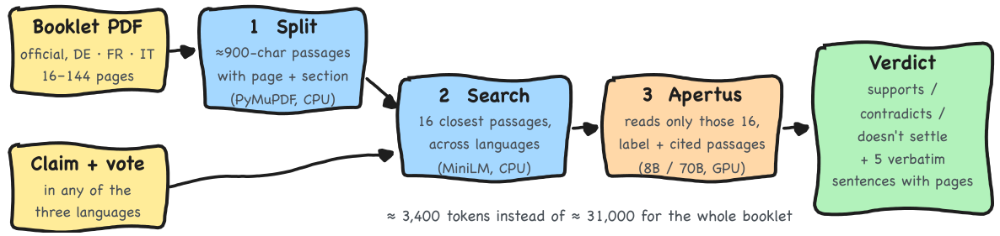
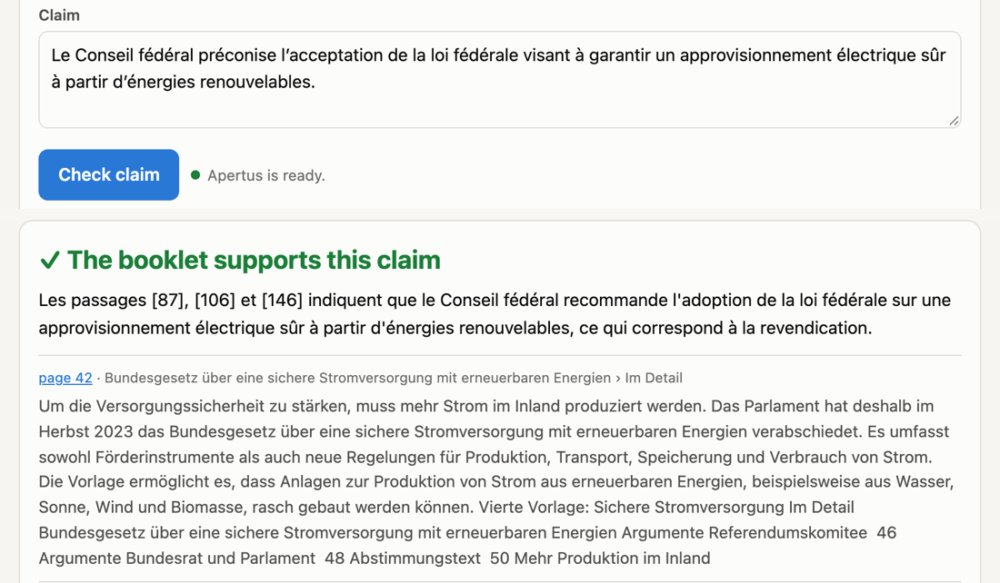
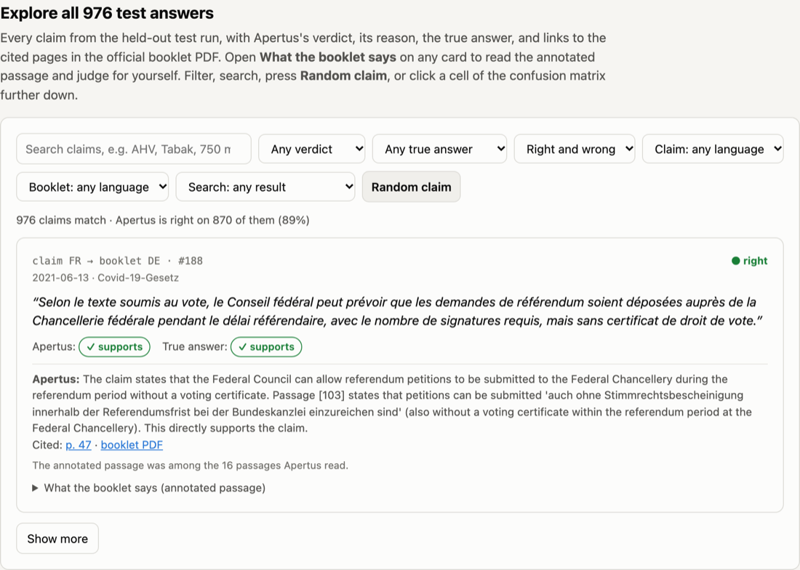

# Büchli

**Checking campaign claims against the official Swiss voting booklet, in German, French and Italian, with Apertus.**

[](https://github.com/kaiser-data/hack-apertus-booklet-nli/actions/workflows/image.yml)
[](LICENSE)
[](https://huggingface.co/swiss-ai/Apertus-v1.5-70B)
[](https://hackapertus.ch)

Before every federal vote, each Swiss household receives the *Abstimmungsbüchli*, the Federal
Council's official explanations. During the campaign, voters meet claims that may or may not match
it, often in another language than the booklet they read. Büchli takes a booklet and a claim and
answers whether the booklet **supports**, **contradicts** or **doesn't settle** the claim, quoting
the sentences and pages it relied on. It judges what the booklet says, not whether a claim is true,
and it is not voting advice.

<p align="center">
  
</p>

## Results

| Setting | Model | Booklet + claim (macro-F1) | Given passage + claim | Evidence Hit@5 | Input tokens / claim |
|---|---|---|---|---|---|
| Held-out test, 976 claims, 14 unseen vote dates (booklet claims, own scorer) | 8B | 0.891 (95% CI 0.869–0.913) | n/a | n/a | 3,424 |
| Same 60 test claims, **whole booklet** in the prompt | 8B | 0.735 | n/a (task B has no booklet) | 0.548 (own measure) | 31,402 |
| Dev, 150 claims per task, organisers' scorer | 8B | 0.857 | 0.930 | 0.768 | 3,349 |
| Dev, 150 claims per task, organisers' scorer, mean of 4 runs | 70B | 0.918 | 0.977 | 0.816 | 3,349 |
| Held-out test, 976 claims per task, organisers' scorer | 8B | 0.884 (95% CI 0.864–0.905) | **0.979** | 0.799 | 3,446 |
| **Held-out test, 976 claims per task, organisers' scorer** | **70B** | **0.930** (95% CI 0.909–0.950) | **0.970** | **0.844** | 3,446 |

The submitted image uses the 70B: it wins on the booklet task and on evidence, while with a given
passage both models are near the ceiling. Reading 16 retrieved passages instead of the whole booklet is more
accurate at a ninth of the tokens. Intervals are bootstrapped over the 14 test vote dates. Where the
model still fails, and what we tried against it, is in the report.

## Efficiency and cost

| Per claim | Apertus-v1.5-8B | Apertus-v1.5-70B |
|---|---|---|
| LLM input tokens (booklet / given passage) | 3,349 / 2,286 | 3,349 / 2,286 |
| LLM output tokens (booklet / given passage) | 86 / 75 | 91 / 76 |
| Whole booklet in the prompt instead (baseline) | 31,402 input tokens | not run (booklets exceed our 32k-token 70B context) |
| End-to-end time in the image, median (booklet / given passage) | 3.9 s / 2.9 s | 4.9 s / 2.9 s |
| Processing outside the LLM (parsing, search, quotes) | 0.22 s | 0.22 s |
| GPU used | 1× NVIDIA L40S | 2× NVIDIA H200 |
| GPU cost per 1,000 claims | ≈ $0.46 | ≈ $3.75–6.48 |

One Apertus call per claim. Costs use Modal's list prices (L40S $1.95/h, H200 $4.54/h each,
October 2026) and our measured wall time on a warm server with 6 parallel requests; more parallel
requests lower them, and idle minutes before the server scales down and cold starts (a few minutes)
come on top. Retrieval runs on CPU in the container. Measurements: dev runs in
[`track_2a/runs/contract-dev-n150/`](track_2a/runs/contract-dev-n150); the 0.22 s is a booklet-only run.

## See it

<p align="center">
  
  
</p>

*Left: the demo, a French claim against the German booklet of 9 June 2024. Right: the explorer, one
of the 976 held-out test answers.* During the hackathon both are hosted at
[booklet-nli.pages.dev/demo](https://booklet-nli.pages.dev/demo/) and
[booklet-nli.pages.dev](https://booklet-nli.pages.dev/); the GPU sleeps when idle, so a first claim
can wait a few minutes. Both are in this repository and run without the hosted site: the explorer is
a single file ([`track_2a/docs/results.html`](track_2a/docs/results.html)), the demo is
[`track_2a/modal/demo.py`](track_2a/modal/demo.py).

## Quick start

The published image follows the Hack Apertus evaluation contract: JSONL in, JSONL out, CPU only, no
downloads at runtime. Any OpenAI-compatible endpoint serving Apertus v1.5 works.

```bash
export BASE_URL=https://api.inference.cscs.ch/v1 API_KEY=...
docker run --rm --platform linux/amd64 -e BASE_URL -e API_KEY \
  -v "$PWD/track_2a/examples:/data:ro" -v "$PWD/out:/output" \
  ghcr.io/kaiser-data/hack-apertus-booklet-nli:latest \
  --input /data/cases.jsonl --output /output/predictions.jsonl
```

Each line of `predictions.jsonl` holds the label (0 entailment, 1 neutral, 2 contradiction), up to five
verbatim evidence sentences with their PDF page, and the tokens and time used. Without Docker:

```bash
cd track_2a && uv sync
uv run booklet-nli predict --booklet <booklet.pdf or URL> --claim "Le Conseil fédéral recommande …"
```

More commands (batch, evaluation, retrieval benchmarks, serving Apertus on Modal) are in
[`track_2a/README.md`](track_2a/README.md).

## How it works

1. **Split**: PyMuPDF turns the booklet into passages of about 900 characters, each with its page
   and section.
2. **Search**: a small multilingual embedder finds the 16 passages closest to the claim, across
   languages, on the CPU.
3. **Decide**: Apertus reads only those 16 and returns the label and the passages it relied on, as
   JSON. The image uses Apertus-v1.5-70B when the endpoint serves it, else the 8B.
4. **Quote**: up to five verbatim sentences with their page numbers become the evidence.

## Repository

| Path | What it is |
|---|---|
| [`track_2a/kaiser-data_Report.pdf`](track_2a/kaiser-data_Report.pdf) | The technical report (6 pages); LaTeX source in [`track_2a/paper/`](track_2a/paper/report.tex) |
| [`track_2a/technical_report.md`](track_2a/technical_report.md) | Archival long version: every experiment, including the rejected ones |
| [`track_2a/src/booklet_nli/`](track_2a/src/booklet_nli) | The system; [`cases.py`](track_2a/src/booklet_nli/cases.py) is the Docker entrypoint |
| [`track_2a/runs/`](track_2a/runs) | Every prediction and score behind the numbers above |
| [`track_2a/modal/`](track_2a/modal) | Apertus servers (8B, 70B), the demo, and the benchmark runners |
| [`track_2a/docs/results.html`](track_2a/docs/results.html) | Explorer of all 976 test answers (one self-contained file) |
| [`.github/workflows/image.yml`](.github/workflows/image.yml) | Builds and publishes the image after an offline contract check |

## Data, models and credits

- Benchmark: [OSTswiss/MNLIoverSwissVotingBooklets](https://huggingface.co/datasets/OSTswiss/MNLIoverSwissVotingBooklets)
  (MIT), split by vote date into dev (6 dates) and test (14 dates).
- Booklets: Swiss Federal Chancellery, [bk.admin.ch](https://www.bk.admin.ch/de/sammlung-der-abstimmungsbuechlein-seit-1978).
- Models: [Apertus-v1.5-8B](https://huggingface.co/swiss-ai/Apertus-v1.5-8B) and
  [Apertus-v1.5-70B](https://huggingface.co/swiss-ai/Apertus-v1.5-70B) (Swiss AI Initiative) decide;
  [paraphrase-multilingual-MiniLM-L12-v2](https://huggingface.co/sentence-transformers/paraphrase-multilingual-MiniLM-L12-v2)
  retrieves.
- Built for [Hack Apertus](https://hackapertus.ch) 2026, Track 2A (challenge by OST), from the
  [project template](https://github.com/HackApertus/project-template). Development used AI coding and
  review assistants; the report's "Use of AI" section says which and for what.

```bibtex
@misc{kaiser2026buechli,
  author = {Kaiser, Martin},
  title  = {B\"uchli: checking campaign claims against the official voting booklet with Apertus},
  year   = {2026},
  howpublished = {\url{https://github.com/kaiser-data/hack-apertus-booklet-nli}},
  note   = {Hack Apertus 2026, Track 2A (OST)}
}
```

Code under the [Apache-2.0](LICENSE) licence. All Hack Apertus projects are open source
([terms](https://hackapertus.ch/terms-and-conditions)).
